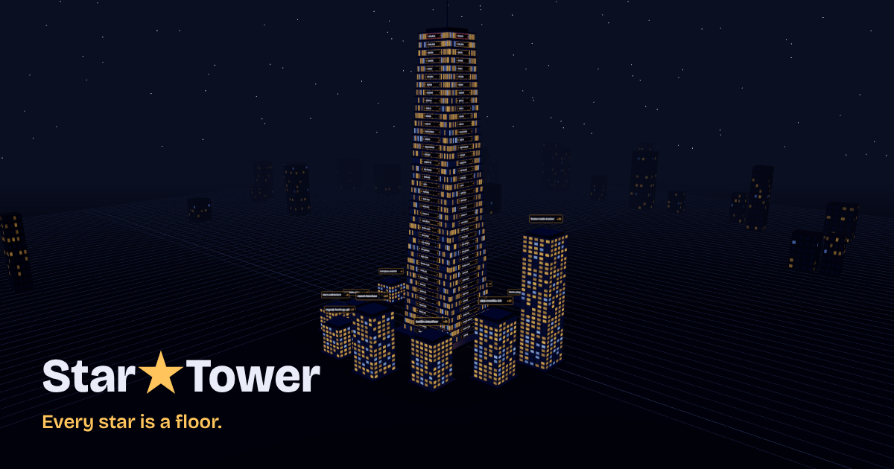

# Star Tower

**Every star is a floor. Find yours.**

Star Tower turns a GitHub profile into a small 3D night city. Every public repository becomes a building that rises one floor per star. In the middle stands the main tower: the people who starred your repos the most live at the top.

**Live:** https://nisaefendioglu.github.io/StarTower/



## Features

- **A building for every repo.** Up to 60 public, non-fork repositories, arranged in rings around the main tower. Height follows the star count, and each floor is one person who starred the repo.
- **Main tower of your biggest fans.** Ranks everyone by how many of your repos they starred. The top fan gets the penthouse.
- **Sign in with GitHub.** Your own city is built with every name and avatar.
- **Share your city.** One button copies your link and publishes your city with names, so anyone who opens it sees who lives where. You can take it down at any time.
- **Find your floor.** Visitors type their own username and the buildings they starred light up, with the month they starred each one.
- **Links, not searches.** Cities open from shared links (`?u=username`). Visitors without a link see a sample city.
- Rising-floor animation, orbit and zoom, hover tooltips, a collapsible side panel, keyboard and reduced-motion support, and a phone layout with a bottom sheet.

## How it works with GitHub's stargazer rules

In 2026 GitHub limited the list of who starred a repository to the repository's owners and collaborators. Star Tower works within that rule:

| Who is looking | What they see |
| --- | --- |
| The owner, signed in | Their own city with every name |
| Anyone opening a shared link | The named city its owner shared |
| Anyone opening a link to a city that was not shared | Buildings by star count, a main tower of the most-starred repos, and *Find your floor* |

*Find your floor* uses a visitor's own public list of starred repositories, which GitHub still makes public.

## Tech stack

| Part | Technology |
| --- | --- |
| UI | React 18, Vite 5 |
| 3D | Three.js, React Three Fiber, drei (OrbitControls) |
| Textures | Canvas 2D: building facades, window grids and name signs are drawn at runtime |
| Fonts | Bricolage Grotesque, IBM Plex Mono (Google Fonts) |
| API | Cloudflare Worker (free plan): GitHub proxy with an allowlist and in-memory cache, GitHub OAuth sign-in, published cities in Workers KV |
| Hosting | GitHub Pages, deployed by GitHub Actions on every push to `master` |

## Project structure

```
src/
  App.jsx                 state, selection, data loading, sign-in
  components/
    Scene.jsx             the 3D scene (loaded lazily)
    Tower.jsx, Floor.jsx  main tower and its floors
    RepoCity.jsx          repo buildings, floor picking, signs
    City.jsx              ground, lights, sky, horizon
    CameraRig.jsx         eases the camera to the selected floor or building
    ControlPanel.jsx      sign-in, sharing, Find your floor, floor list
    DetailPanel.jsx       person, repo and visitor panels
  lib/
    github.js             GitHub API access and local cache
    auth.js               GitHub sign-in and publishing
    shape.js              turns raw data into the tower and city layout
    textures.js           facade and sign textures
    i18n.js               all UI text
worker/
  src/index.js            Cloudflare Worker: proxy, OAuth, published cities
  setup-token.sh          stores the server's GitHub token
  setup-login.sh          sets up GitHub sign-in and the KV store
```

## Run locally

```bash
npm install
echo "VITE_API_BASE=https://star-tower-api.nisaefendioglu.workers.dev" > .env.local
npm run dev
```

Without `VITE_API_BASE` the site talks to GitHub directly, which works for repo lists and *Find your floor* but not for names.

## Deploy your own

1. **Worker.** In `worker/`, set your domain in `ALLOWED_ORIGINS` inside `wrangler.toml`, then run `npx wrangler login` and `npx wrangler deploy`.
2. **Server token.** `bash worker/setup-token.sh` stores a classic token with only the `public_repo` scope. The worker uses it only for two read-only GitHub endpoints.
3. **Sign-in.** Create a GitHub OAuth App with the callback URL `https://<your-worker>/auth/callback`, then run `bash worker/setup-login.sh`.
4. **Site.** Set `VITE_API_BASE` in `.github/workflows/deploy.yml`, push to `master`, and choose **Settings → Pages → Source: GitHub Actions**.

Everything above runs on free plans. Cloudflare's free plan needs no card. Requests over its daily limit fail for the rest of the day instead of being billed.

## Privacy

- Signed-in tokens stay in the visitor's browser tab and are removed when the tab closes. The worker never stores them.
- Published cities are opt-in, and the owner can take them down at any time.
- The worker only reads two GitHub endpoints and refuses everything else.

## License

MIT
